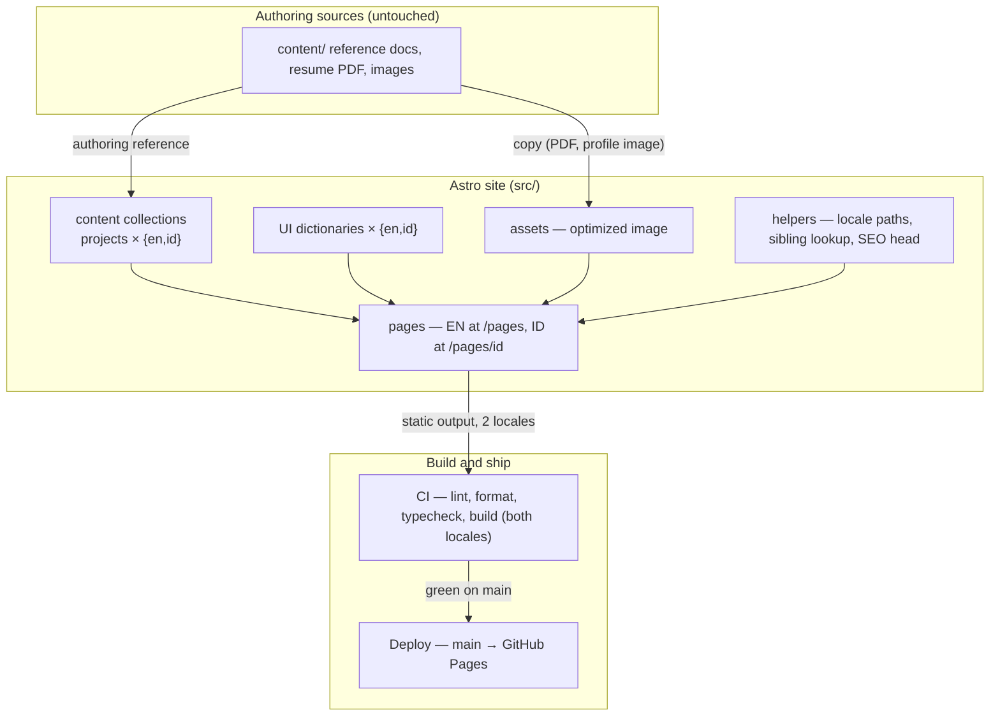

# feat: Bilingual portfolio site (Astro + React + TS)

## Summary

Build the entire portfolio in dependency order: the contributor spine first (branch `main`, contributor docs, CI, production deploy), then the site foundation (design tokens, layout, i18n, content collections), then the bilingual pages and content. Everything ships from the origin brainstorm's requirements — nothing narrowed, nothing added beyond what those requirements already imply.

---

## Problem Frame

Silfaradila has professional material of unusual care — verification gates, redaction labels, bilingual source docs — but no web presence (see origin: `docs/brainstorms/2026-11-09-bilingual-portfolio-requirements.md`, Problem Frame). The repo itself is empty of code: `content/` holds three reference documents, a resume PDF and three images; git has zero commits on `master`; the GitHub repo is public. The brainstorm fixed what to build; this plan fixes how, on a stack where the repo offers zero local patterns to follow.

---

## Requirements

Carried from the origin document (see origin for full rationale):

**Site and stack**

- R1. Astro, React and TypeScript, fully static output, no backend; content authored as markdown in the repo.
- R2. English at `/`, Indonesian at `/id/`; every v1 page in both locales, with a language switcher mapping between locale equivalents.
- R3. Navigation shows only live sections; Personal Lab and Engineering Journal entries appear only when those sections launch.

**Pages (v1)**

- R4. Home per design.md's blueprint: hero (headline, tagline, chips, availability, Explore Projects / Download Resume / Contact Me CTAs), brief introduction, three featured projects, technical expertise table, journey timeline, closing CTA.
- R5. About: about-text, areas of interest, engineering philosophy, experience links to projects — no education section.
- R6. Projects listing: title, category, short overview, role, tech stack, disclosure status, case-study link where one exists.
- R7. Three full case studies (SIMS, CSSD, Prophesy AI Prime) in design.md's structure with "Professional Project" and "Partially Redacted" labels.
- R8. Six remaining professional projects as compact entries — role, stack, one-paragraph overview, honest status; entries state only confirmed facts.
- R9. Resume page: summary, experience, selected projects, skills, PDF download — no education section; English PDF at launch, Indonesian page serves it labeled as English until an Indonesian PDF exists.
- R10. Contact: headline, open-to description, Yogyakarta, Indonesia • silfaradilamei@gmail.com • www.linkedin.com/in/silfaradila/ • github.com/thisilfa.

**Content honesty**

- R11. Verification gates enforced: resume-only metrics stay out of case studies until confirmed; CSSD never described as production-ready; the Internal AI Agent labeled exploratory research, never a built or deployed system.
- R12. No confidential material; every case study carries its disclosure note.
- R13. Company / independent / experimental distinction visible on every project entry, both locales.

**Contributor workflow**

- R14. CONTRIBUTING.md adopts the begaya spine: one issue = one branch = one PR with the same title, Conventional Commits with `Refs #N`, rebase-merge, merged branches deleted.
- R15. Solo adaptations: no project board, milestones, or priority fields; area labels `area: site`, `area: content`, `area: docs`, `area: deps`, `area: ci`.
- R16. CI on every PR and main: lint, format, typecheck, and a build producing both locales; merge only when green.
- R17. Merge to main deploys production directly; PRs get build checks; no staging.

**Findability**

- R18. Locale-correct meta titles/descriptions, Open Graph tags, sitemap.xml, hreflang alternates pairing EN and ID.

**Acceptance examples (origin)**

- AE1. Language switch from the Indonesian SIMS case study lands on the English SIMS case study, not the English home.
- AE2. During v1 no route exists for Personal Lab or Engineering Journal; nav shows exactly five entries in both locales.
- AE3. No degree, institution, or coursework text renders anywhere on the site in either locale; the downloadable PDF contains it.
- AE4. The Internal AI Agent entry shows an exploratory-research status with no delivery, deployment, or ownership claim.

---

## Key Technical Decisions

- **Astro 7, current major (not the origin's implied Astro 5).** Research found Astro at 7.4.7 with v6 breaking changes that shape all collection code: config lives in `src/content.config.ts`, every collection needs a loader, `render(entry)` replaces `entry.render()`, `getEntryBySlug()` is gone, and `z` imports come from `astro/zod`. Node 24, npm (the deploy action's default).
- **Astro's built-in i18n routing, unprefixed default.** `i18n.routing` with `prefixDefaultLocale: false` produces exactly EN at `/` and ID at `/id/`; locale page folders must match the `locales` list. No fallback routing — full parity means no page exists in only one locale, and a genuinely missing page should 404 rather than serve the wrong language. The known hallucinated key `routing: 'prefixOtherLocales'` does not exist; it is `routing: { prefixDefaultLocale: false }`.
- **One collection per content type, locale in the entry id.** A `projects` collection globs `{en,id}/**/*.md` under one directory with one shared Zod schema; the documented filter pattern (`id.startsWith('en/')`) selects a locale, and sibling lookup swaps the prefix. This keeps one `CollectionEntry` type for both languages and structurally guarantees pairing.
- **Interface copy in TS dictionaries; long-form content in collections.** Nav labels, buttons and section headings come from a UI-dictionary module per locale (the official i18n recipe pattern); case studies and compact entries are markdown with Zod schemas.
- **Zero islands in v1.** `@astrojs/react` is installed per the stack choice, but the nav, language switcher and all pages ship as Astro components with a few lines of vanilla script — hydrating them would put the React runtime on every page for no benefit. React stays reserved for genuinely stateful widgets.
- **GitHub Pages project site, base-path discipline.** `site: 'https://thisilfa.github.io'`, `base: '/thisilfa-porto'`. Every hand-written `public/` reference — resume download links, OG image, sitemap `<link>` — is prefixed with the base; imported images from `src/` are prefixed automatically. Default `build.format: 'directory'` stays (GitHub Pages serves directories); `trailingSlash: 'never'` is not configured.
- **Design tokens as CSS custom properties.** The dark restrained-cyberpunk system (palette drawn from the chosen artwork's magenta/purple neon on a deep dark surface, glow and grid effects used sparingly) lives in one global stylesheet with fonts via Astro's Fonts API, `color-scheme: dark`, and WCAG AA body-text contrast as a hard constraint.
- **Site visuals are copies; `content/` is untouched.** The chosen profile visual (`content/Neon Cat Lover’s Cyberpunk Lounge.png`) is copied into the optimized-image location under a URL-friendly name; the resume PDF is copied to the public download spot as `public/downloads/silfaradila-mei-resume-en.pdf`. Nothing in `content/` moves or gets deleted.
- **Begaya-shaped tooling.** npm scripts mirror begaya's naming (`lint`, `typecheck`, `format:check`, `check`); ESLint with the Astro plugin plus Prettier; `astro check` inside the build script since neither `astro build` nor `tsc` type-checks `.astro` files.
- **Default branch becomes `main` before the first push.** The repo sits on a commit-less `master`; the workflow, CI triggers and PR base all assume `main`.

---

## High-Level Technical Design



---

## Output Structure

```text
├── .github/
│   ├── workflows/ci.yml
│   ├── workflows/deploy.yml
│   ├── ISSUE_TEMPLATE/issue-template.md
│   └── PULL_REQUEST_TEMPLATE.md
├── public/
│   ├── downloads/silfaradila-mei-resume-en.pdf
│   ├── og-default.png
│   └── favicon.svg
├── src/
│   ├── assets/profile/neon-cat-lounge.png
│   ├── content.config.ts
│   ├── content/
│   │   └── projects/
│   │       ├── en/*.md
│   │       └── id/*.md
│   ├── components/ (header, footer, language-switcher, project-card, …)
│   ├── i18n/ui.ts + i18n/utils.ts
│   ├── layouts/base.astro
│   ├── lib/content.ts
│   ├── lib/i18n.test.ts
│   ├── lib/content.test.ts
│   ├── pages/ (en: index, about, projects/, resume, contact, 404)
│   ├── pages/id/ (mirrors)
│   └── styles/global.css
├── CONTRIBUTING.md
└── README.md
```

---

## Implementation Units

### Phase A — Contributor spine

### U1. Project scaffold

- **Goal:** A runnable Astro 7 + React + TypeScript project with the full toolchain and both deploy-shaping config values in place.
- **Requirements:** R1, R2 (config), R16 (scripts)
- **Dependencies:** none
- **Files:** `package.json`, `astro.config.mjs`, `tsconfig.json`, `.gitignore`, `src/pages/index.astro` (placeholder), `src/styles/global.css` (empty token sheet), `eslint.config.js`, `.prettierrc`, `src/lib/i18n.test.ts` (empty suite), `src/lib/content.test.ts` (empty suite)
- **Approach:** `astro.config.mjs` sets `site` + `base`, the `i18n` block (`locales: ['en','id']`, `defaultLocale: 'en'`, `routing: { prefixDefaultLocale: false }`), the React and sitemap integrations, and the sitemap `i18n` locale map (`en → en-US`, `id → id-ID`). Scripts: `dev`, `build` (`astro check && astro build`), `astro check` as `typecheck`, `lint`, `format`, `format:check`, `test` (`vitest run`), `test:build` (assertions over `dist/` after a build), and a root `check` chaining lint, format, typecheck, and test. Dev dependencies include vitest for the helper suites built in U6/U7. Pin exact versions.
- **Patterns to follow:** begaya's script naming; `tsconfig` extends `astro/tsconfigs/strict` with `jsx: react-jsx`.
- **Test scenarios:** Test expectation: none — scaffolding; correctness is `npm run check` and `astro build` passing, verified in this unit's own verification.
- **Verification:** `npm run check` passes end to end; the dev server serves the placeholder page; `astro build` emits a `dist/` whose paths all carry the `/thisilfa-porto` base.

### U2. Contributor workflow files

- **Goal:** The begaya spine, adapted for a solo static repo, in writing before any content PR exists.
- **Requirements:** R14, R15
- **Dependencies:** U1 (scripts the docs reference)
- **Files:** `CONTRIBUTING.md`, `README.md`, `.github/ISSUE_TEMPLATE/issue-template.md`, `.github/PULL_REQUEST_TEMPLATE.md`
- **Approach:** CONTRIBUTING.md keeps the spine — one issue = one branch = one PR with the same title, Conventional Commits with `Refs #N`, rebase-merge, merged branches deleted — and drops the org ceremony (project board, milestones, priority/effort). Local conventions: the workflow's commit types (nearly everything is `feat` or `content`; the area labels are the five from the origin), the branch naming `<type>/<issue>-<slug>`, and the repo-specific facts: base `main`, `npm run check` before opening a PR, staging deploys do not exist. The PR template asks for Problem / What changes / Verification and `Closes #N`; the issue template asks for problem, scope, and what is deliberately left out. README covers what the site is, the tech stack, local setup, and the one-time Pages setting (Source: GitHub Actions).
- **Patterns to follow:** begaya-here's CONTRIBUTING.md structure (sibling project, outside this repo).
- **Test scenarios:** Test expectation: none — documentation.
- **Verification:** A new contributor could open a correct issue, branch, and PR using only these files; `main` is the default branch on GitHub after the first push.

### U3. CI and production deploy

- **Goal:** Every PR checks lint/format/typecheck/both-locale build; every merge to `main` lands on GitHub Pages.
- **Requirements:** R16, R17
- **Dependencies:** U1 (scripts), U2 (workflow conventions)
- **Files:** `.github/workflows/ci.yml`, `.github/workflows/deploy.yml`
- **Approach:** Before any workflow runs, this unit performs the git bootstrap the spine needs: rename the local branch from `master` to `main`, make the initial commit, and push `main` to origin as the default branch (the repo has zero commits, so bootstrap commits land on `main` directly — CONTRIBUTING documents this one-time exception). `ci.yml` mirrors begaya's shape — triggers on PRs to `main` and pushes to `main`, a concurrency group that cancels superseded runs, minimal permissions, Node 24 with npm caching — running `npm run check` (lint, format, typecheck, unit tests) and `astro build` followed by `test:build` in one job, plus begaya's distinctive "every commit" job on PRs (checkout each commit in the range, run `npm run check`) since rebase-merge lands commits as written. `deploy.yml` triggers on pushes to `main` only, with `contents: read`, `pages: write`, `id-token: write` permissions, builds via the official Astro action, and deploys via the official Pages deploy action with a `github-pages` environment and its own concurrency group. The two workflows stay separate so PRs never touch the deploy pipeline.
- **Test scenarios:** Test expectation: none — pipeline config; correctness is the first green run.
- **Verification:** A PR shows the CI checks going green; merging to `main` produces a deployed site at the github.io project URL; the repo's Pages source is set to GitHub Actions (one-time setting, documented in the README).

### Phase B — Site foundation

### U4. Design system foundation

- **Goal:** The dark restrained-cyberpunk visual identity as reusable tokens, before any page consumes them.
- **Requirements:** R1's styling basis; the origin's Key Decision "Dark with restrained cyberpunk character"
- **Dependencies:** U1
- **Files:** `src/styles/global.css`, `astro.config.mjs` (fonts block)
- **Approach:** CSS custom properties for the palette (deep dark surface, layered elevations, magenta/purple/violet neon accents sampled from the chosen artwork), typography scale, spacing rhythm, and the two signature effects — a subtle glow for accents and a faint grid or scanline texture — each defined once so restraint is enforceable. The token sheet includes interactive states — hover, active, and a high-visibility focus-visible ring that passes WCAG focus contrast on the dark surface — so components never improvise them; the effects are static, and any future animation respects `prefers-reduced-motion`. Fonts self-hosted via Astro's Fonts API, configured in `astro.config.mjs` (latin subset, only used weights); the layout consumes only the generated CSS variables. `color-scheme: dark` and a `theme-color` meta. Body text contrast meets WCAG AA; neon is for accents, never body text.
- **Patterns to follow:** the chosen artwork's palette as the source of truth for accent hues.
- **Test scenarios:** Test expectation: none — styling; contrast and restraint verified by eye in U8's pages.
- **Verification:** Tokens render on the placeholder page; body-text contrast passes AA against the dark surface; the effects read as "developer" without hurting readability.

### U5. Base layout, navigation, and 404

- **Goal:** One base layout carrying SEO head slots, header, footer, and mobile nav; nav shows exactly the five live sections; a branded 404.
- **Requirements:** R3, AE2; R18's head plumbing
- **Dependencies:** U1, U4
- **Files:** `src/layouts/base.astro`, `src/components/header.astro`, `src/components/footer.astro`, `src/components/mobile-nav.astro`, `src/pages/404.astro`, `src/i18n/ui.ts` (first dictionaries: nav and footer labels)
- **Approach:** The layout takes locale, title, description, and an OG image that defaults to the site-wide OG asset (U8 adds it to `public/`); renders `<html lang>` per page (never once globally), the favicon link, and the sitemap link. Nav lists the five live sections — Home, About, Projects, Resume, Contact — as a plain array in the UI dictionary; a future section launch edits that array in both locales. Mobile nav is an Astro component with a few lines of vanilla script: a toggle button with `aria-expanded`, Escape-to-close, and focus return; no hydration. The 404 is bilingual — copy and home links for both locales, since GitHub Pages serves one 404.html for every path.
- **Test scenarios:**
  - Build renders the nav with exactly five entries on a page in each locale. Covers AE2.
  - The 404 page's home link includes the `/thisilfa-porto` base.
- **Verification:** Both locale placeholders render inside the layout with correct `lang`, working mobile nav, and five-entry navigation.

### U6. i18n routing, language switcher, and SEO head

- **Goal:** Locale equivalence mapping that passes the switch acceptance case, plus a complete per-page SEO head.
- **Requirements:** R2, R18, AE1
- **Dependencies:** U5 (layout to host the head and switcher)
- **Files:** `src/i18n/utils.ts`, `src/i18n/ui.ts` (extended), `src/components/language-switcher.astro`, `src/lib/i18n.test.ts`, `src/components/seo-head.astro`
- **Approach:** Locale path helpers wrap Astro's `getRelativeLocaleUrl` / `getAbsoluteLocaleUrl`, with a translate-path function that strips the current locale segment, swaps in the target, and falls back to the localized home when no equivalent exists. The switcher renders the destination locale as a link built from the current path — trailing slash normalized before the locale swap — and the current locale as a non-interactive label carrying `aria-current="true"`; anchors only, no script needed for the core behavior. The SEO head emits: per-locale meta title/description from the page's props, canonical, an hreflang cluster of absolute URLs (`en-US`, `id-ID`, self-referencing entry, `x-default` pointing at the unprefixed URL) — the same tag set the sitemap map uses, so head and sitemap never drift — Open Graph tags with the base-prefixed absolute image URL (the page's OG image or the site default), the favicon link, and the sitemap `<link>`. The sitemap integration's `serialize` adds `x-default` alternates, which the integration never emits on its own.
- **Test scenarios:**
  - Translating `/projects/sims/` from `en` yields the ID case-study path, and the inverse holds. Covers AE1.
  - Translating a path with no equivalent yields the target locale's home (fallback), not a 404 link.
  - Helpers on a locale not in the configured list throw rather than emit a wrong URL (edge).
  - The hreflang cluster for a page contains exactly `en-US`, `id-ID`, self, and `x-default`, all absolute and base-prefixed.
  - The switcher's current locale is a non-interactive `aria-current` label, not a self-link.
  - Integration: the built `sitemap-0.xml` includes the `/thisilfa-porto` base in every URL and carries `x-default` alternates.
- **Verification:** Switching language on any built page lands on the equivalent page in the other locale; view-source shows the full hreflang cluster; the sitemap passes the base check.

### U7. Content collections and bilingual helpers

- **Goal:** The typed data layer for all project content — one schema, two locales, structurally guaranteed pairing.
- **Requirements:** R6–R8's data basis, R12's disclosure field, R13's ownership fields
- **Dependencies:** U1
- **Files:** `src/content.config.ts`, `src/content/projects/en/.gitkeep`, `src/content/projects/id/.gitkeep`, `src/lib/content.ts`, `src/lib/content.test.ts`
- **Approach:** One `projects` collection, glob loader over `{en,id}/**/*.md`, shared Zod schema: title, category, overview, role (optional — absent where no source states one), company (optional), stack (string array), status (optional free text, present only where a source states one), statusKind (enum: delivered / staging / research / unverified — the honesty label; `unverified` renders as "resume-described; not independently verified"), ownership (enum: employer / independent / unconfirmed, sourced from the reference doc's ownership table), disclosure (required on every entry — compact entries carry a one-line visibility note, case studies the full note), kind (enum: case-study / compact), featured (boolean, case studies only), order. Helpers: filter by locale via the id prefix, fetch a sibling by prefix swap, a deterministic sort (featured, then order, then title), and `assertLocalePairing` — throws naming any entry whose sibling is missing, called from the projects pages' loading path so a missing translation fails the build. Helpers are pure functions over passed-in entries and paths with thin wrappers around `astro:content` / `astro:i18n`, so the vitest suites can mock those virtual modules (`vi.mock`) instead of importing them. Import `z` from `astro/zod`; entries render via the standalone `render()` import.
- **Test scenarios:**
  - A case-study entry without a disclosure note fails schema validation (error path).
  - Locale filtering returns only that locale's entries for a mixed fixture directory (happy path).
  - Sibling lookup returns the paired entry when it exists and `undefined` when the translation is missing (edge).
  - `assertLocalePairing` passes on complete fixtures and throws naming the orphan on an incomplete one (edge: pairing).
  - Every fixture entry carries non-empty `disclosure`, `ownership`, and `statusKind` values (schema gate).
  - Sorting is stable and deterministic across repeated runs (edge — collection order is non-deterministic without an explicit sort).
- **Verification:** The suite passes against the fixture directory; `astro sync` accepts the schema; both helper suites are green in `npm run check`.

### Phase C — Pages and content

### U8. Core pages: Home, About, Contact

- **Goal:** The recruiter's first three pages, fully bilingual, consuming the design system and collections.
- **Requirements:** R4, R5, R10, AE3 (About arm); R3 (nav stays five entries)
- **Dependencies:** U4–U7
- **Files:** `src/pages/index.astro`, `src/pages/about.astro`, `src/pages/contact.astro`, `src/pages/id/` mirrors, `src/components/project-card.astro`, `src/components/section-heading.astro`, `src/i18n/ui.ts` (extended), `src/assets/profile/neon-cat-lounge.png` (copied from `content/`), `public/og-default.png` (1200×630), `public/favicon.svg`
- **Approach:** Home follows design.md's six sections — hero (headline, tagline, expertise chips, availability note, three CTAs), brief introduction, three featured project cards from the collection, the technical expertise table (stacked as grouped chips or a definition list below the mobile breakpoint, full table on wider viewports), the journey timeline, closing CTA. The hero stays server-rendered HTML for LCP; the profile image appears on About, imported from `src/assets` so Astro optimizes the ~2 MB source into responsive formats. About carries the about-text draft, areas of interest, engineering philosophy, and experience links — no education section anywhere. Contact carries the real details with base-safe external links. All labels come from the UI dictionaries.
- **Test scenarios:**
  - Home renders exactly three featured cards in each locale, drawn from the collection (happy path).
  - The hero CTAs resolve to the Projects listing, the resume PDF (the single English file, base-prefixed, served from both locales until an Indonesian PDF exists), and Contact in both locales (integration).
  - No degree, institution, or coursework string appears in either locale's built About or Home HTML. Covers AE3.
  - Contact renders the location, email, LinkedIn, and GitHub links in both locales.
- **Verification:** All six home sections present in both locales; the About page shows the optimized portrait; Lighthouse's quick pass shows no image- or LCP-sized regression.

### U9. Projects listing and three case studies

- **Goal:** The professional portfolio's core: the listing page and SIMS, CSSD, and Prophesy AI Prime as full bilingual case studies.
- **Requirements:** R6, R7, R12; R11's verified-metrics gate
- **Dependencies:** U7, U8 (cards, layout)
- **Files:** `src/pages/projects/index.astro`, `src/pages/projects/[slug].astro`, `src/pages/id/projects/` mirrors, `src/content/projects/en/{sims,cssd,prophesy}.md`, `src/content/projects/id/{sims,cssd,prophesy}.md`
- **Approach:** The listing shows every project entry with the R6 field set — disclosure status and the ownership label included; case-study cards link to detail pages, compact entries render inline detail (U10 adds their content). The loading path runs U7's `assertLocalePairing` before rendering. Case-study pages render design.md's section structure — Overview, My Responsibilities, Technical Implementation, Results, What I Learned, Disclosure Note — under "Professional Project" and "Partially Redacted" labels. Content comes from the two reference docs; the SIMS accuracy figure appears only with design.md's approved phrasing (metric-definition caveat), and CSSD's status reads staging, never production.
- **Test scenarios:**
  - Each case-study entry resolves to a built page in both locales at base-prefixed paths (integration).
  - Every case study renders a disclosure note and both labels (happy path).
  - A case-study entry missing its translation fails the build's pairing check (error path).
  - The CSSD page contains no production-readiness claim (content assertion).
- **Verification:** All three case studies read fully in both locales; listing and detail pages carry correct hreflang clusters; wording matches the reference docs' verification gates.

### U10. Compact entries for the six remaining professional projects

- **Goal:** The complete career picture without six new long write-ups.
- **Requirements:** R8, R11, R13, AE4
- **Dependencies:** U9 (listing renders both kinds)
- **Files:** `src/content/projects/en/` and `id/`: clinical-lab-scheduling, workguard, face-attendance, cbir-tokoquick, yolov5-counting, ai-agent-research (`.md` pairs)
- **Approach:** Each entry: role (where a source states one), stack, one-paragraph overview, honest statusKind, ownership, and a one-line disclosure note. Where the reference doc states no role or status, the entry states only what is confirmed. The Internal AI Agent entry carries the research/exploratory label and no delivery, deployment, or ownership claim; resume-only metrics stay out until their definitions are verified. The ownership distinction (employer vs independent vs exploratory) is visible on every card, both locales.
- **Test scenarios:**
  - The listing renders nine project entries in each locale — three case studies plus six compact (happy path). Covers the origin's project census.
  - The AI Agent entry's statusKind is research and its text contains no built/deployed/shipped claim. Covers AE4.
  - Every compact entry has a same-locale sibling for both locales and non-empty statusKind, ownership, and disclosure (edge: pairing).
- **Verification:** The listing shows the full professional history in both locales; spot-check wording against the reference doc's gates.

### U11. Resume page and downloadable PDF

- **Goal:** The web resume with a working download, honest fallback for the missing Indonesian PDF, and education only in the PDF.
- **Requirements:** R9, AE3 (resume arm)
- **Dependencies:** U5–U8
- **Files:** `src/pages/resume.astro`, `src/pages/id/resume.astro`, `public/downloads/silfaradila-mei-resume-en.pdf` (copied from `content/`)
- **Approach:** The resume page renders professional summary, work experience, selected projects, and technical skills from the reference material — no education section. The download link is base-prefixed to the copied PDF. The Indonesian page serves the same English PDF with a label saying the resume is available in English until an Indonesian version exists; adding that PDF later is a copy-plus-one-content-entry change. The page offers no education content, keeping the site-wide education boundary (AE3) intact.
- **Test scenarios:**
  - The download link resolves to the committed PDF at its base-prefixed path (integration).
  - The ID resume page renders an explicit "available in English" label next to the download (happy path).
  - Neither locale's resume page contains degree, institution, or coursework strings. Covers AE3.
- **Verification:** Download works from both locale pages on the built site; page content matches the latest resume PDF's facts.

---

## Scope Boundaries

**Deferred for later** (carried from the origin)

- Personal Lab — returns when a personal project has real publishable material; design.md's ideas table lists five lab projects but its sitemap lists four (Edge AI Benchmarking dropped) — resolve the list at launch.
- Engineering Journal — returns when the first article exists.
- Graduating compact entries (U10) into full case studies.

**Outside this product's identity** (carried from the origin)

- No backend, CMS, comments, or dynamic server features — a portfolio is static content.
- No staging environment or release-tag machinery — merge to `main` deploys.
- No claim inflation — verified claims only, "Partially Redacted" labels, experiments never presented as delivered products.

**Deferred to follow-up work**

- Pointing a custom domain (launch is the default github.io URL; a domain attaches later without rework).
- First React island, when a genuinely stateful widget earns the runtime cost.

---

## Risks & Dependencies

- **Indonesian resume PDF does not exist.** Mitigated in U11: the ID page serves the English PDF, labeled. Producing the PDF is an owner content task, not engineering.
- **Sitemap base-path history.** The sitemap integration has a known history of dropping `base` on subpath deployments; U6's integration test checks `sitemap-0.xml` for the base, with `serialize` as the rewrite lever if alternates come out wrong.
- **GitHub Pages source setting.** The deploy action requires the repo's Pages source set to GitHub Actions — a one-time manual step in the repo settings, documented in the README and verified in U3.
- **Large source images.** The chosen portrait is ~2 MB; Astro's image pipeline optimizes it at build time, but the repo carries all three source images (~6 MB total) since `content/` stays untouched. One-time cost, acceptable for a portfolio repo.
- **Astro 7 is the current major.** Minor-version churn is possible during the build; versions are pinned exactly in U1 and upgrades go through the normal PR flow.

---

## Sources & Research

- Origin: `docs/brainstorms/2026-11-09-bilingual-portfolio-requirements.md` — requirements, honesty gates, scope boundaries, and the real contact details carried into R4–R11.
- `content/design.md` — page blueprint, per-case-study structure, "Partially Redacted" labels, disclosure notes; explicitly excludes visual design.
- `content/Silfaradila_Project_Experience_Reference.md` + `content/Referensi_Pengalaman_Proyek_Silfaradila_Bahasa_Indonesia.md` — 9 projects with ownership/evidence table and verification gates; the authoring source for U9–U11 content.
- `content/Neon Cat Lover’s Cyberpunk Lounge.png` — the chosen profile visual (portrait); `content/Silfaradila Mei_AI Engineer_Resume.pdf` — the EN resume.
- Astro docs (v7): internationalization guide, `astro:i18n` module, i18n recipe, content collections, React integration, GitHub Pages deploy guide, sitemap integration, CLI reference (`astro check`), TypeScript guide.
- Known pitfalls from research: `routing: 'prefixOtherLocales'` does not exist (config schema verified in Astro source); sitemap base-path issue (withastro/astro#2422); `astro:i18n` helper trailing-slash conflict (#17034); `x-default` never emitted by the sitemap integration (add via `serialize`).
- Begaya-here `CONTRIBUTING.md` and `.github/workflows/ci.yml` (sibling repo, outside this one) — the workflow and CI shapes adapted in U2/U3, including the "every commit" PR job.
- Verified repo state: `content/` (3 documents, 1 PDF, 3 images), zero commits, branch `master`, origin `github.com/thisilfa/thisilfa-porto`, repo public (Pages free).
