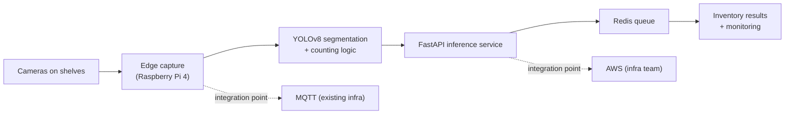

# feat: Case-study depth — SIMS gold standard

## Summary

Build the template infrastructure for evidence-led case studies — contribution groups, architecture-diagram pattern, project-type metadata, employment-period dates — then rewrite SIMS in both locales as the gold standard under it. CSSD and Prophesy replicate in the follow-up round after the owner approves SIMS.

---

## Problem Frame

The shipped case studies describe what was built, not how problems were approached, who owned what, or what evidence supports results (see origin: `docs/brainstorms/2026-11-10-case-study-depth-requirements.md`). The owner's audit pinned the facts; this plan turns them into template infrastructure and the first case study that meets the improvement guide's §13 standard.

---

## Requirements

Carried from the origin document (full rationale there):

- R1. Each professional case study renders the full template in both locales: Overview (page header); My contribution (page-level section — a documented deviation from the guide's template order, rendered after the header because page-level sections cannot sit inside the markdown body); Problem & constraints; System architecture (generalized diagram + written explanation); Technical implementation with decision rationale; Experiments & engineering challenges; Results & evaluation with defined metrics; Demonstration & evidence; Limitations & reflection; Disclosure note.
- R2. Sections without documented material are omitted or carry one honest sentence.
- R3. SIMS ships first; CSSD and Prophesy replicate later.
- R4. SIMS's metric publishes exactly as decided by the owner (2026-11-10): "Peak average daily item-counting correctness of 98.6% in October, measured by comparing detected inventory counts against actual inventory quantities" — 98,6% in the Indonesian locale, October time context always included, never labeled model accuracy or shelf-level accuracy. If the exact wording cannot be supported by the source material, results go qualitative.
- R5. SIMS contribution split per the audit (implemented: YOLOv8 retraining/experimentation/evaluation, counting logic, FastAPI server, Redis queue, monitoring + discrepancy review, targeted data collection, pipeline integration; contributed: AWS deployment, MQTT integration, service integration into the broader system; designed & proposed: centralized inference architecture; not individually attributed: camera setup, frontend/dashboard/reporting).
- R6. Headers carry employment periods verbatim from the resume — never project windows.
- R7. Required `type` enum (professional / independent / research) on every entry; 8 professional + AI agent research.
- R8. Listings reflect the type without breaking the nine-entry census.
- R9. SIMS gets a generalized architecture diagram (camera capture → edge inference → YOLOv8 segmentation → counting logic → FastAPI service → Redis queue → inventory results; AWS and MQTT as marked integration points), no confidential names.
- R10. Sanitized screenshots stay deferred; the design reserves evidence places without faking content.
- R11. The guide's §10 checklist gates publication of each case study.

**Acceptance examples (origin)**

- AE1. A visitor finishing SIMS can state the problem, the flow, the ownership boundaries, and what the metric measures.
- AE2. No hedged or undefined figure remains in SIMS results.
- AE3. Both locales carry every template section; omissions are symmetric.
- AE4. Listings render nine entries per locale, AI agent under research.

---

## Key Technical Decisions

- **New `type` enum field, not a renamed `category`.** `category` already carries the technical domain (Computer Vision, …) on all 18 entries; renaming it would churn every file for no content gain. `type` (professional / independent / research, required) carries the classification the origin calls "category".
- **Contribution as structured frontmatter.** An optional `contribution` array of `{ group, items }` — group enum `implemented | contributed | proposed | unattributed`, items as locale-native text inside each entry's markdown file. The page renders groups in that fixed order with localized labels, skipping empty groups; "designed & proposed" is its own group because proposing an architecture is a different ownership claim from implementing one. The section renders after the page header — a documented deviation from the guide's body order, forced by page-level rendering (owner-approved). The unattributed group renders as a single muted line; implemented, contributed, and proposed keep bullets (owner-approved hierarchy).
- **Diagrams as page-level inline-SVG components behind a slug-keyed map.** Astro markdown cannot render components without MDX (a forbidden dependency), so the diagram cannot sit inside the body: entries declare `diagram: sims` in frontmatter and `[slug].astro` maps that to the component, rendered between the contribution section and the prose; the body's Architecture section carries the written explanation. Zero JavaScript, zero new dependencies, full token styling. Three ownership treatments — implemented (solid), contributed/integration (dashed), context/unattributed (muted) — camera and edge-capture render as context per the audit; a localized legend inside the SVG explains the treatments (owner-approved).
- **Grouped listing sections, not filters.** Headings "Professional Experience" and "Research & Experiments" (owner-selected wording); the census is 8 + 1 per locale. Listing page H1, lede, and SEO description update to cover both groups. `independent` has no heading this round — no entry uses it; the Personal Lab round adds a third heading before the first independent entry.
- **`period` as an optional string, locale-native.** English values copy the resume verbatim — "July 2025 – Present" (Biologic), "Jun 2023 – Jun 2024" and "Jun 2024 – Jun 2025" (Quick Tractor); Indonesian entries use "Juli 2025 – sekarang", "Juni 2023 – Juni 2024", "Juni 2024 – Juni 2025". Rendered on case-study headers and compact cards, only on entries whose role is attributed; unattributed entries (clinical-lab-scheduling, ai-agent-research) carry none.
- **Metric validation as an exact structured check.** The build asserts the exact decided sentence (EN "Peak average daily item-counting correctness of 98.6% in October…", ID equivalent with "98,6%") — or its complete absence with qualitative results. No proximity windows.

---

## High-Level Technical Design

The SIMS diagram U3 authors as SVG — this is its content design (generalized; ownership-encoded styling; no confidential names):

Implemented stages (SEG→API→Q→OUT) render solid; contributed integration points (MQTT, AWS) render dashed; context stages (CAM, EDGE — not individually attributed per the audit) render muted. The legend explains all three treatments.

---

## Implementation Units

### U1. Schema and entry metadata

- **Goal:** The typed fields every later unit consumes — `type`, `contribution`, `period` — present on all 18 entries.
- **Requirements:** R5 (data), R6, R7
- **Dependencies:** none
- **Files:** `src/lib/project-schema.ts`, all 18 files in `src/content/projects/{en,id}/`, `src/i18n/ui.ts` (group labels + listing headings), `src/lib/content.test.ts` (fixtures gain `type`, and `contribution`/`period` once exercised)
- **Approach:** `type` required enum (`professional | independent | research`); `contribution` optional array of `{ group: implemented|contributed|proposed|unattributed, items: string[] }`; `period` optional string. Entries: `type: professional` on the eight professional entries — sims, cssd-instrument-id, prophesy-ai-prime, clinical-lab-scheduling, workguard, face-attendance, cbir-tokoquick, yolov5-counting — and `research` on ai-agent-research (independent stays reserved for future Personal Lab entries). `period` only on role-attributed entries, locale-native: EN files "July 2025 – Present" (three Biologic case studies), "Jun 2024 – Jun 2025" (workguard, face-attendance), "Jun 2023 – Jun 2024" (cbir-tokoquick, yolov5-counting); ID files "Juli 2025 – sekarang", "Juni 2024 – Juni 2025", "Juni 2023 – Juni 2024" respectively. Contribution data lands in U4 for SIMS, leaving the field optional until then. Dictionary additions per locale: the four contribution-group labels, the two listing-group headings ("Professional Experience" / "Research & Experiments"), and revised listing page copy (H1 "Projects", lede, SEO description covering both groups).
- **Test scenarios:**
  - Schema rejects an entry without `type` (error path).
  - Schema rejects a `type` outside the enum (error path).
  - A `contribution` array with an unknown group value fails validation (error path).
  - `period` is optional and passes through verbatim (happy path).
- **Verification:** `npm run check` green with all 18 entries parsing; `astro build` succeeds with the required field on every entry.

### U2. Case-study and listing rendering

- **Goal:** The page surfaces for the new data: grouped contribution section, period under role, grouped listing sections.
- **Requirements:** R1 (contribution section), R6, R8, AE3, AE4
- **Dependencies:** U1
- **Files:** `src/pages/projects/[slug].astro`, `src/pages/id/projects/[slug].astro`, `src/pages/projects/index.astro`, `src/pages/id/projects/index.astro`, `src/components/project-card.astro`
- **Approach:** Contribution renders as a page-level labeled section immediately after the header (the documented order deviation): groups in fixed order (implemented → contributed → proposed → unattributed), localized labels, bullets for implemented/contributed/proposed, and the unattributed group collapsed to a single muted line. Period renders under the role in the case-study header and on cards where present. Listings split into two heading-labeled groups ("Professional Experience" / "Research & Experiments") from the same sorted data, with the page's H1, lede, and meta description updated to cover both groups; total cards remain nine per locale.
- **Test scenarios:**
  - A case study with contribution data renders exactly the non-empty groups in fixed order, with localized labels (happy path).
  - A case study without contribution data renders no contribution section (edge — until U4 fills SIMS).
  - An entry without `period` renders no period text (edge).
  - Both listing locales render the research heading group containing exactly the AI agent card, and the professional group containing eight (integration).
- **Verification:** Built pages show the contribution section for any entry carrying data; listings show the two groups; `npm run check` green.

### U3. SIMS architecture diagram

- **Goal:** The generalized, ownership-encoded SIMS diagram as a page-level inline-SVG component.
- **Requirements:** R9, R1 (architecture section), R10
- **Dependencies:** U1 (design tokens exist; no data dependency)
- **Files:** `src/components/diagram-sims.astro`, `src/pages/projects/[slug].astro`, `src/pages/id/projects/[slug].astro`
- **Approach:** Inline SVG per the HTD sketch with three treatments — solid for implemented stages (segmentation → API → Redis → results), dashed for contributed integration points (MQTT, AWS), muted for context stages (cameras, edge capture — not individually attributed) — plus a localized legend inside the SVG explaining the three treatments. `role="img"` with localized `<title>`/`desc` props passed per page; stage labels stay in technical English, which is language-neutral. Embedding: entries declare `diagram: sims` in frontmatter and the `[slug].astro` pages map that slug to the component, rendered between the contribution section and the prose body (markdown cannot host components without MDX). The diagram sits in a horizontal scroll container with a visible scroll affordance on small screens (owner-approved) so the six-stage flow stays legible at phone width.
- **Test scenarios:** Test expectation: none — visual authoring; presence, accessibility attributes, and the legend are asserted by U5's build checks.
- **Verification:** Both locale SIMS pages embed the component; the SVG carries `role="img"`, localized title/desc, and the localized legend; the scroll container works at mobile width.

### U4. SIMS gold-standard content

- **Goal:** SIMS rewritten to the full template in both locales — the standard CSSD and Prophesy will replicate.
- **Requirements:** R1–R6, R11, AE1, AE2, AE3
- **Dependencies:** U1, U2, U3
- **Files:** `src/content/projects/en/sims.md`, `src/content/projects/id/sims.md`
- **Approach:** Frontmatter gains the contribution array (audit facts, R5), period, and `diagram: sims`. Body sections: Problem & constraints (manual counting bottleneck, occlusion/stacking, edge hardware limits, operational monitoring requirements); Architecture — written explanation of the diagram rendered by the page (no duplicate Overview heading; the header already carries it); Technical implementation with decision rationale restricted to documented material — centralized inference (requirement: duplicate YOLO loading and Pi instability → approach: centralized serving → documented previous state: per-device models → outcome: stable inference, at the cost of depending on the network path) and geometry-based counting (requirement: hidden boxes in stacked shelves → approach: spatial inference from visible surfaces → outcome), with Redis queueing described as part of the pipeline (no invented alternatives or trade-offs beyond the sources); Experiments & engineering challenges from documented material only — daily discrepancy categorization (model / counting-logic / environmental), targeted overexposure and occlusion data collection, and their observed effects; Results carrying the decided metric sentence exactly — EN "Peak average daily item-counting correctness of 98.6% in October, measured by comparing detected inventory counts against actual inventory quantities.", ID with "98,6%" — never labeled model or shelf-level accuracy; Demonstration & evidence — one honest sentence noting sanitized screenshots and sample imagery await owner-approved material; Limitations & reflection (unattributed components, disclosure constraints, what remains unvalidated). Indonesian mirrors every section.
- **Execution note:** Draft the EN body first, get the structure right, then translate — the owner reviews the gold standard before replication, so structural choices concentrate here.
- **Test scenarios:**
  - Covers AE2. The SIMS results section matches exactly one allowed state: the figure appears only within N characters of the shelf-level definition phrase, or no figure appears and qualitative results stand.
  - Covers AE1. Both locales render Problem & constraints, My contribution, System architecture (with the diagram), decision-rationale content, Experiments & challenges, Results, Limitations — every template section.
  - Covers AE3. The EN and ID bodies render the same section set (symmetry).
  - The contribution section contains the four groups with the audit's items and no unattributed components listed as implemented.
  - The education-term scan still passes (no education content crept in).
- **Verification:** Owner reviews the SIMS pages in the PR as the standard; all U5 checks green in both locales.

### U5. Build verification hardening

- **Goal:** The build permanently enforces the new honesty and parity gates.
- **Requirements:** R4, R7, R8, AE2, AE4
- **Dependencies:** U2, U3, U4
- **Files:** `scripts/test-build.mjs`
- **Approach:** Additions: grouped census (8 professional + 1 research per listing locale, AI agent in the research group); listing copy updated to "Projects" with the both-groups lede in both locales; contribution section present on SIMS pages in both locales with the audit's groups, no unattributed component listed as implemented, and the unattributed group rendered as the muted single line; SIMS metric check as exact structured validation — the EN page contains the decided sentence with "98.6%" and the October context, the ID page its "98,6%" equivalent, or both pages carry no figure at all (no proximity windows); period strings present on the seven attributed entries' cards and on the three Biologic case-study headers, absent on the two unattributed entries; SIMS pages embed an `role="img"` SVG carrying the localized legend.
- **Test scenarios:**
  - All added assertions pass on the built site (happy path).
  - Mutation check: removing the shelf-level phrase while keeping the figure makes the metric check fail (error path — verifies the proximity rule).
- **Verification:** `npm run test:build` green with the new gates; CI runs them on every future PR.

---

## Scope Boundaries

**Deferred for later** (carried from origin)

- CSSD and Prophesy replication — the immediate follow-up round once the owner approves the SIMS standard.
- Personal Lab and Engineering Journal — gated on real material, unchanged.
- Sanitized screenshots and sample imagery — owner-produced evidence.

**Outside this product's identity** (carried from origin)

- No invented alternatives, experiments, or undefined metrics.
- No implying sole ownership of team-wide systems.
- No confidential names, endpoints, or topology in diagrams.

**Deferred to follow-up work**

- CSSD and Prophesy architecture diagrams (their replicate round).
- Wiring owner-produced screenshots into the evidence places.

---

## Risks & Dependencies

- **The metric condition may force qualitative results.** R4's condition is the owner's; if review finds the shelf-level definition inaccurate, U4's results rewrite to qualitative and U5's test already allows that state.
- **Hand-authored SVG is manual maintenance.** One diagram this round; acceptable. If diagrams multiply in the replicate round, revisit a build-time rendering path then.
- **Translation load doubles per template change.** Established parity pattern; U4 drafts English first, then translates.
- **Required `type` fails the build on any missed entry.** Intended — the census gate works by failing loudly; U1 updates all 18 files in one pass.

---

## Sources & Research

- Origin: `docs/brainstorms/2026-11-10-case-study-depth-requirements.md` — audit answers, R1–R11, AE1–AE4, the three deferred questions this plan resolves.
- `content/portfolio_improvement_guide.md` — the template (§5), SIMS plan (§6A), quality checklist (§10), standard (§13).
- `content/Silfaradila_Project_Experience_Reference.md` + Indonesian twin — SIMS responsibilities, decision material, documented experiments (discrepancy categorization, occlusion/overexposure collection, centralized-inference proposal).
- Resume PDF text extract — employment periods copied verbatim (Biologic July 2025 – Present; Quick Tractor Jun 2023 – Jun 2024, Jun 2024 – Jun 2025).
- Verifier pass, 2026-11-10 — confirmed current template sections, schema shape, the hedged 98.6% wording, 18 content files.
- Astro guidance from the v1 plan's research (zero-JS content pages, islands cost) — the basis for the inline-SVG diagram decision.
